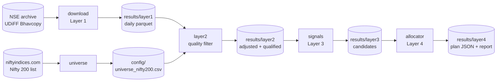
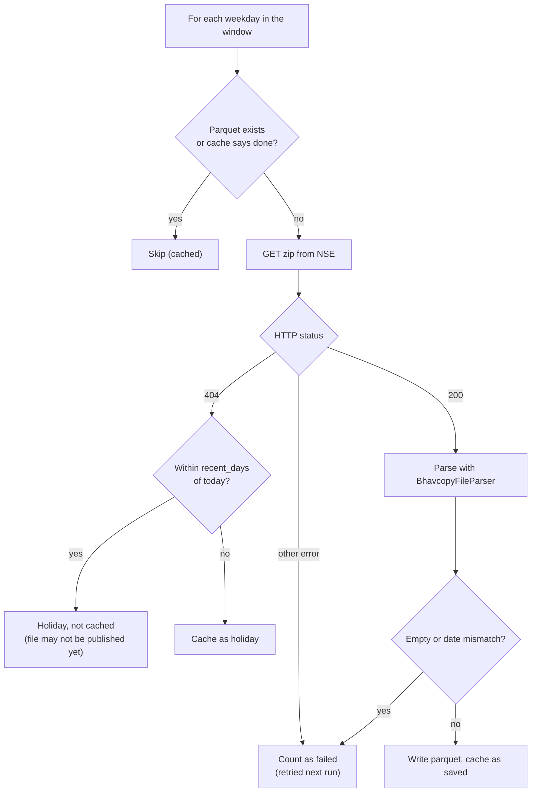
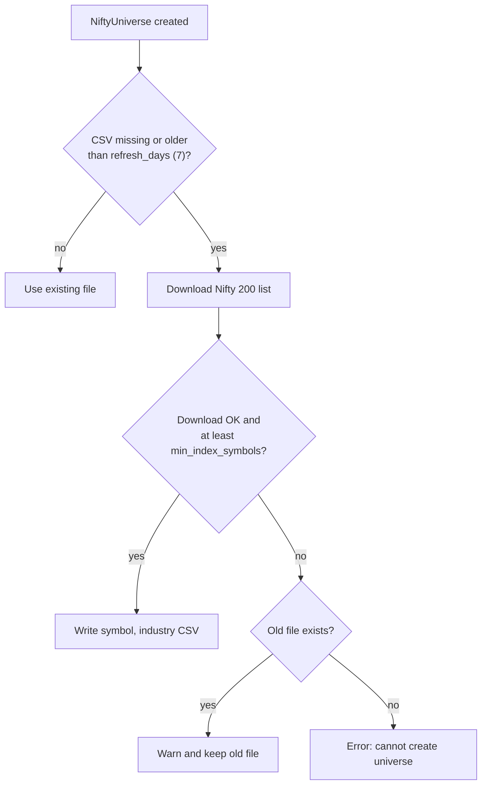
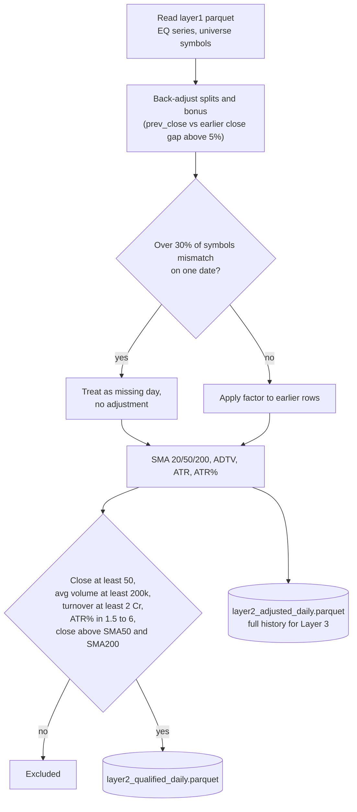
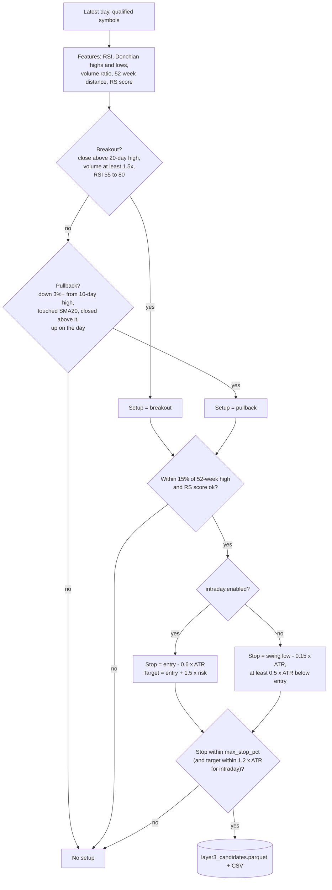
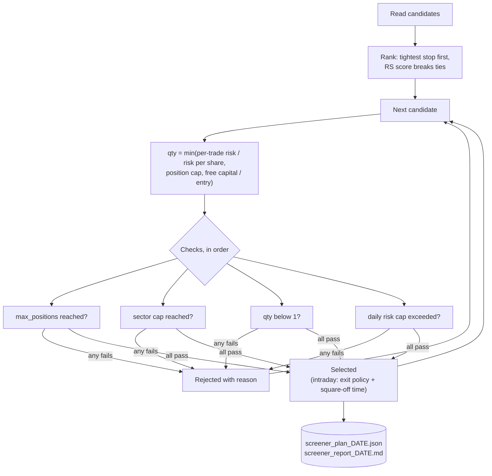

# bhav-copy-downloader

Automated NSE end-of-day screener. It downloads the NSE UDiFF cash-market Bhavcopy, keeps the Nifty 200 stocks that pass quality gates, detects breakout and pullback setups, and writes a risk-sized daily plan within strict INR limits.

The default config is set up for a small account (INR 10,000) and **intraday** trades: ATR-based stop and target, plus an end-of-day square-off tag. Switch `intraday.enabled` to `false` for positional trades with swing-low stops.

> Educational tool only. It does not place orders and is not investment advice. Entry is the last close, used as a reference.

Detailed diagrams for every case (holidays, cache, corporate actions, rejections) are in [docs/ARCHITECTURE.md](docs/ARCHITECTURE.md).

## Quick start

```powershell
python -m venv .venv
.venv\Scripts\pip install -r requirements.txt
cd src
..\.venv\Scripts\python main.py                           # whole pipeline
..\.venv\Scripts\python -m bhav_screener.pipeline --from layer2   # restart at a step
..\.venv\Scripts\python -m bhav_screener.pipeline --only signals  # run one step
```

Steps: `download`, `universe`, `layer2`, `signals`, `allocator`. The pipeline stops at the first failing step and exits with code 1.

All rules live in [config/settings.yaml](config/settings.yaml). Missing keys fall back to defaults in `utils/config.py`; unknown keys or invalid values raise an error at start.

## Pipeline

Each step saves its result to a file, and the next step reads that file instead of memory. Any step can run on its own.



### Layer 1: download

Fetches one Bhavcopy zip per trading day for the last `history_trading_days` (260) and stores a parquet file per day.



A failed day makes the pipeline's download step fail, so Layer 2 never runs on partial data.

### Universe



### Layer 2: quality filter



### Layer 3: signals

Only symbols qualified on the latest date are evaluated. The run fails if the newest stored day is older than `data.max_data_age_days` (4).



### Layer 4: risk allocator



## Output layout

`data/` is git-ignored and recreated by the pipeline.

```text
data/
  cache/bhavcopy-cache.json     which dates are saved or holidays
  status/<layer>_status.json    result of each step (ok, empty, failed)
  results/
    layer1/                     YYYY-MM-DD.parquet per trading day (raw/ holds zips if keep_raw)
    layer2/                     layer2_adjusted_daily.parquet, layer2_qualified_daily.parquet
    layer3/                     layer3_candidates.parquet, layer3_candidates_DATE.csv
    layer4/                     screener_plan_DATE.json, screener_report_DATE.md
```

## Files

| File | Purpose |
|---|---|
| `src/main.py` | Entry point; calls `pipeline.main()` |
| `src/bhav_screener/pipeline.py` | Runs the steps in order, CLI (`--from`, `--only`), writes `pipeline_status.json` |
| `src/bhav_screener/nse_bhavcopy_downloader.py` | Downloads one day's zip from NSE |
| `src/bhav_screener/bhavcopy_backfill.py` | Layer 1: loops over days, parses, writes parquet, uses the cache |
| `src/bhav_screener/filters/corporate_actions.py` | Split and bonus back-adjustment |
| `src/bhav_screener/filters/layer2_filter.py` | Layer 2: indicators and quality gates |
| `src/bhav_screener/filters/signals.py` | Layer 3: breakout and pullback detection, stops, targets |
| `src/bhav_screener/risk_allocator.py` | Layer 4: ranking, sizing, caps, plan and report |
| `src/bhav_screener/utils/config.py` | Typed settings, validation, `layer_path()` |
| `src/bhav_screener/utils/universe.py` | Nifty 200 CSV (`symbol`, `industry`) download and refresh |
| `src/bhav_screener/utils/bhavcopy_file_parser.py` | UDiFF CSV and zip parser |
| `src/bhav_screener/utils/bhavcopy_cache.py` | Saved and holiday date cache |
| `src/bhav_screener/utils/status.py` | Atomic status JSON writer |
| `config/settings.yaml` | All rules and paths |
| `config/universe_nifty200.csv` | Generated universe, refreshed weekly |
| `docs/ARCHITECTURE.md` | Detailed diagrams and edge cases |

## Configuration

Main sections of `config/settings.yaml`:

| Section | Controls |
|---|---|
| `data` | folders, history window, data-age limit, download URL, delay, raw-file keeping |
| `universe` | EQ only, universe file and refresh, corporate-action threshold, price, volume and turnover floors |
| `scanner` | SMAs, breakout, volume, RSI, ATR band, 52-week distance, pullback, positional stop rules, RS |
| `risk` | capital, per-trade and daily INR risk, position size %, max positions, sector cap, ranking |
| `intraday` | on/off, ATR stop, reward/risk, target limit, stop % cap, exit policy, square-off time |

## Limitations

- Delivery percentage is not in the UDiFF file, so only the volume check is applied.
- Sunday special sessions are not downloaded (the backfill skips weekends).
- No order placement; the square-off time is a tag in the plan.
- No automated tests yet.
