# NSE Bhavcopy Screener - What the code does

End-of-day (EOD) pipeline that downloads NSE UDiFF CM Bhavcopy, filters the Nifty 200 universe for quality,
detects breakout / pullback setups, and builds a risk-sized plan within a small INR budget.
Everything is driven by `config/settings.yaml`; nothing in the code needs editing to change a rule.

Run from `src/`:

```
python main.py                                    # whole pipeline
python -m bhav_screener.pipeline --from layer2    # restart at a step
python -m bhav_screener.pipeline --only signals   # run one step
```

Steps: `download -> universe -> layer2 -> signals -> allocator`.

---

## 1. Big picture

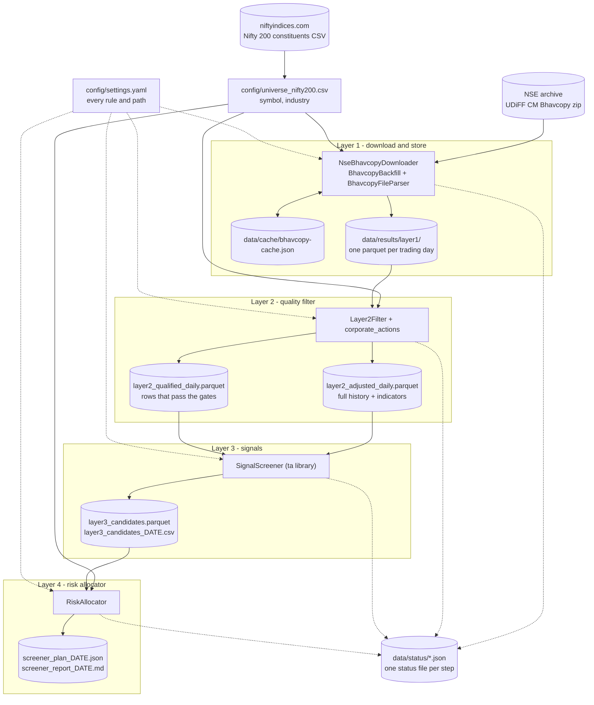

Rule: each step writes its result to a file and the next step reads that file (not memory), so any step can run alone.

---

## 2. Pipeline control flow

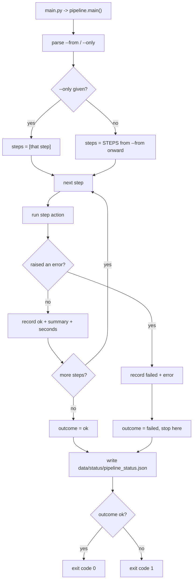

`layer2`, `signals` and `allocator` also write their own `failed` status (with the error) before re-raising.

---

## 3. Layer 1 - download, parse, cache

### 3.1 Backfill loop

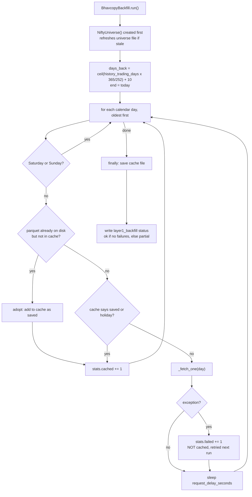

### 3.2 One day

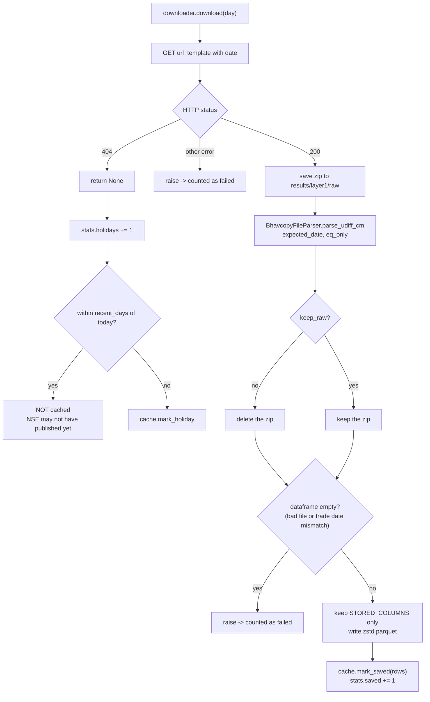

Stored columns: `trade_date, symbol, series, open, high, low, close, prev_close, volume, turnover_cr`.

### 3.3 Cache file

```json
{"2026-11-20": {"status": "saved", "rows": 2760},
 "2026-11-14": {"status": "holiday"}}
```

A date counts as done when it is a holiday, or saved **and** its parquet still exists. If the parquet is deleted, the date is fetched again.

---

## 4. Universe (Nifty 200)

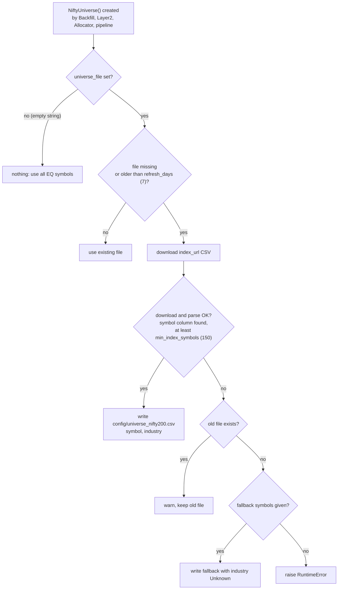

- `symbols()` = CSV symbols plus any listed under `universe.symbols` in settings; empty means all.
- `sector_map()` = symbol to industry; used by the allocator for the sector cap (`Unknown` if missing).
- Rows starting with `NIFTY`, blanks and duplicates are removed when parsing.

---

## 5. Layer 2 - quality filter

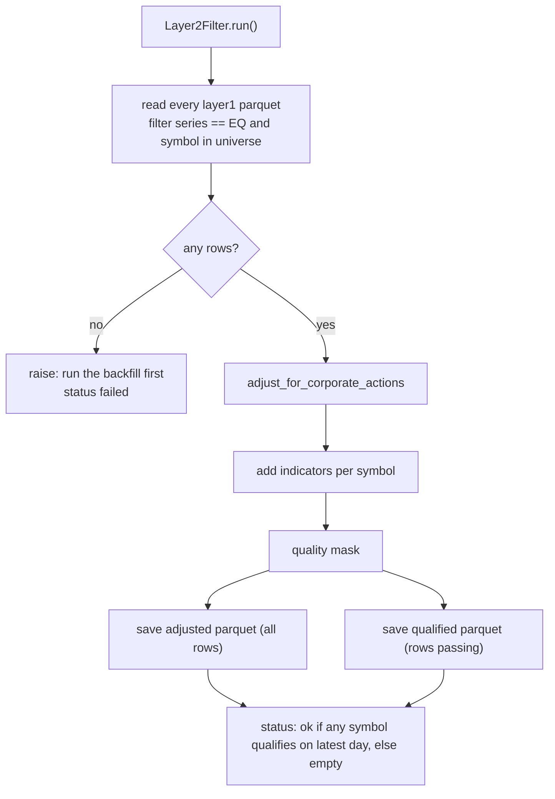

### 5.1 Corporate-action adjustment

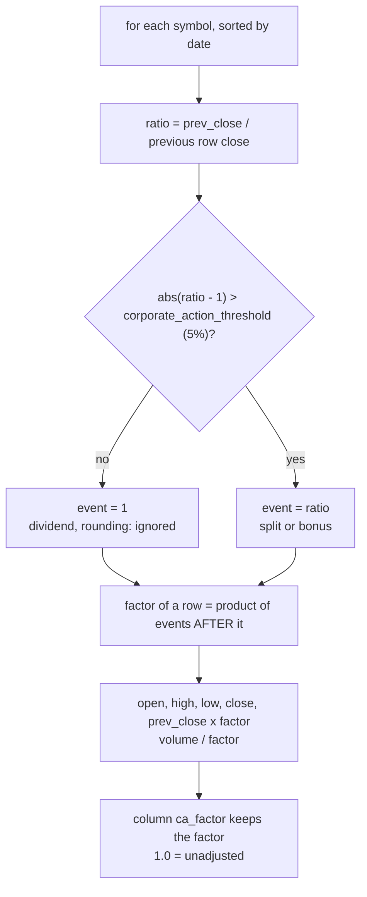

### 5.2 Indicators and gates

| Indicator | Definition |
|---|---|
| `sma_20`, `sma_50`, `sma_200` | rolling mean of close |
| `avg_volume` | 20-day mean volume |
| `adtv_cr` | 20-day mean `turnover_cr` |
| `atr` | true range, exponential mean, alpha = 1/14, needs 14 rows |
| `atr_pct` | `atr / close x 100` |

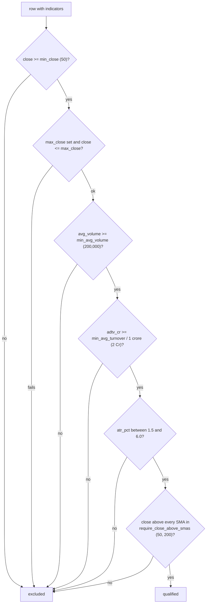

A missing indicator (not enough history) is treated as a fail, so the 200-day SMA needs at least 200 rows per symbol.

---

## 6. Layer 3 - signals

### 6.1 Overall

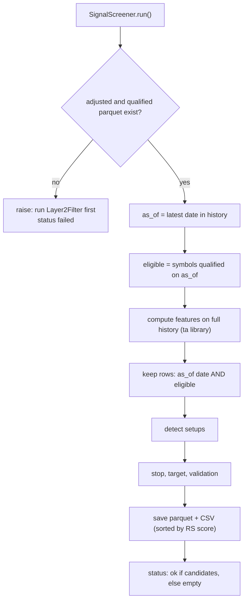

### 6.2 Features

| Feature | How |
|---|---|
| `rsi` | `ta` RSIIndicator, 14 |
| `breakout_high` / `prior_high` | Donchian high over 20 days, shifted 1 day (today excluded) |
| `recent_high` | Donchian high over 10 days (pullback depth) |
| `swing_low_breakout` | Donchian low over 7 days |
| `swing_low_pullback` | Donchian low over 10 days |
| `high_52w` | Donchian high over 252 days (uses available history) |
| `volume_ratio` | volume / mean of the previous 20 days |
| `pct_below_52w_high` | `(high_52w - close) / high_52w x 100` |
| `rs_score` | 126-day return, percentile rank (0-100) across all symbols on the same date |

### 6.3 Setup detection

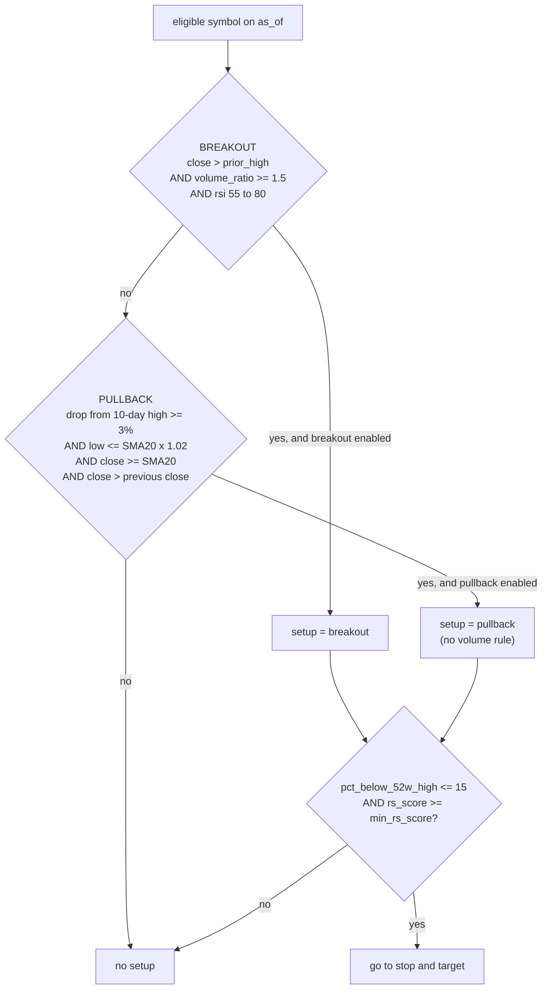

Breakout wins if both match. `scanner.setups` can turn either one off.

### 6.4 Stop, target and validation (two modes)

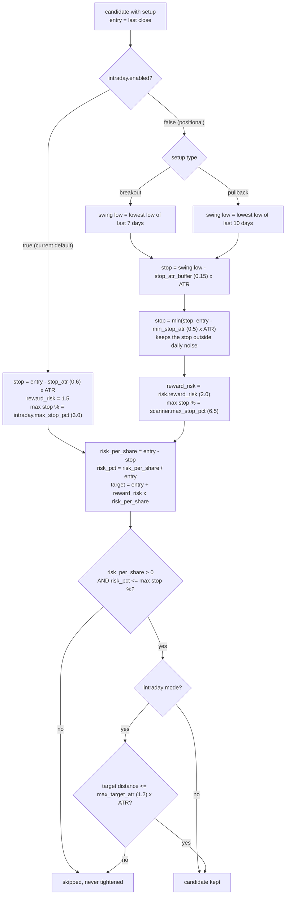

Candidate columns: `trade_date, symbol, setup, entry, stop, risk_per_share, risk_pct, target, rs_score, rsi, volume_ratio, atr_pct, pct_below_52w_high, adtv_cr`.

---

## 7. Layer 4 - risk allocator

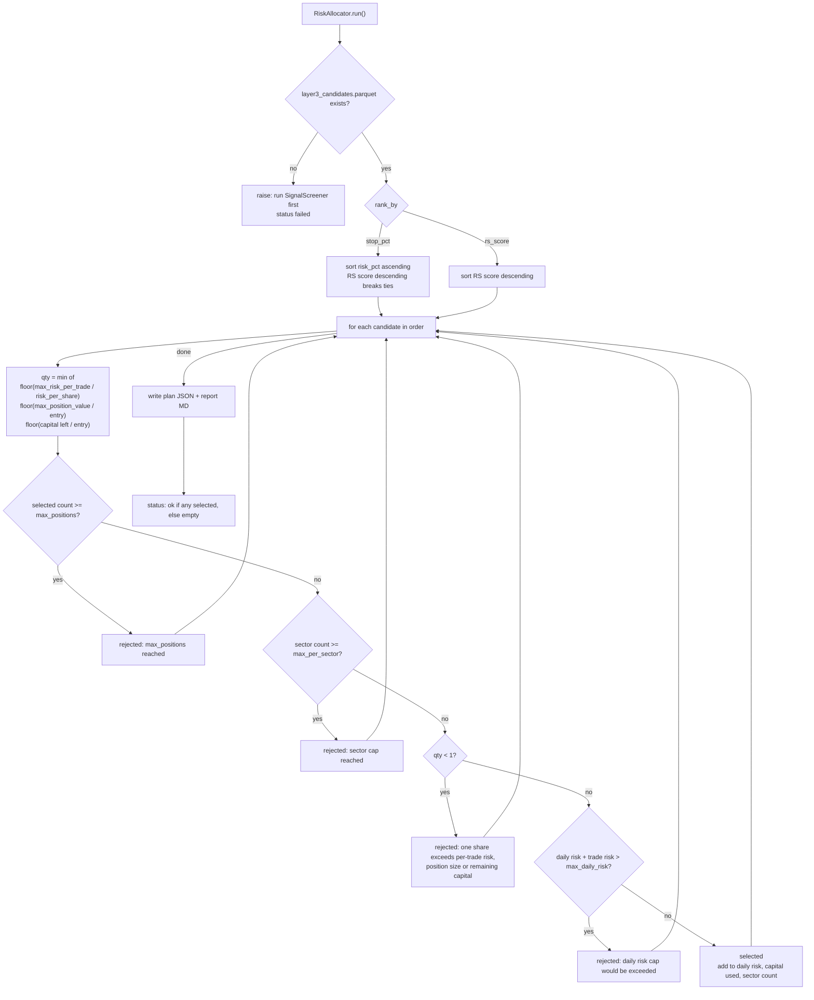

- `max_position_value = capital x max_position_pct / 100`.
- Rejections are checked in the order above, so the reason shown is the first rule that failed.
- In intraday mode every selected trade also carries `exit_policy: EOD_MANDATORY_CLOSE` and `square_off_time` (default `15:15`). This is a tag only; the project does not place or close orders.
- With no candidates the plan file is named `screener_plan_none.json`.

Plan JSON: `as_of_date`, `limits` (including `capital_inr`, `rank_by`), `summary` (`candidates_in`, `selected`, `total_risk_inr`, `total_position_value_inr`, `capital_left_inr`), `selected[]`, `rejected[]`.

---

## 8. Data folder

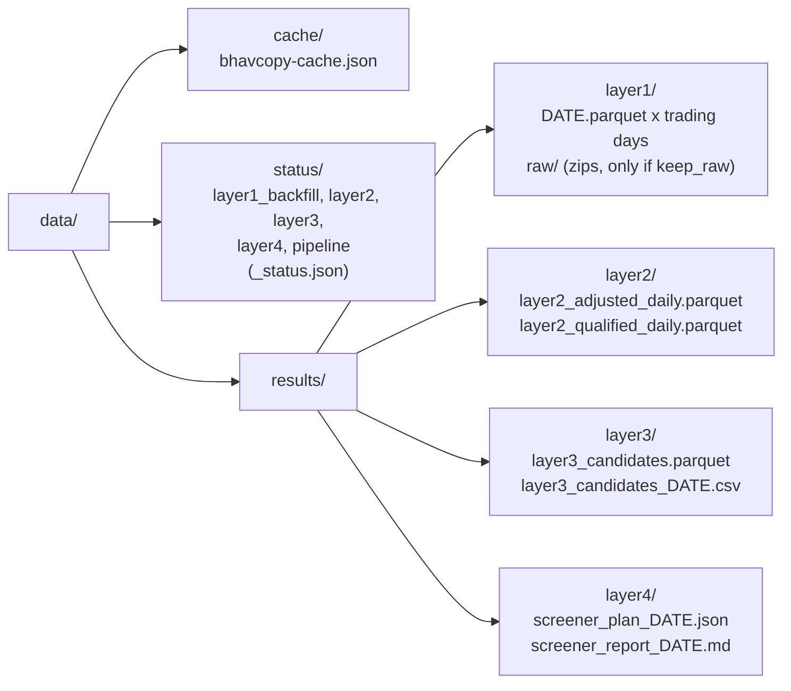

`data/` is git-ignored and can be deleted at any time; the next run rebuilds it.

### Status files

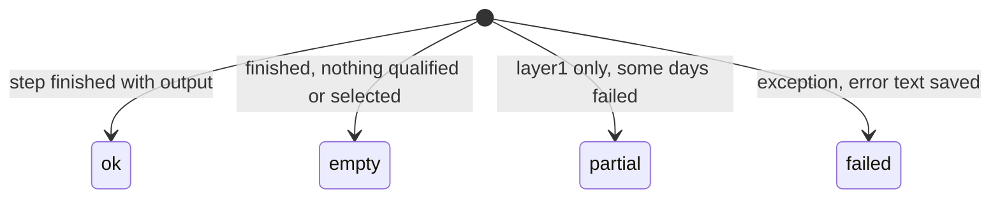

Each file is written atomically to `data/status/<layer>_status.json` with the run details (counts, file paths, symbols).

---

## 9. Code map

```
config/settings.yaml                      all rules
config/universe_nifty200.csv              auto-created, refreshed weekly
src/main.py                               calls pipeline.main()
src/bhav_screener/
  pipeline.py                             ScreenerPipeline, CLI
  nse_bhavcopy_downloader.py              HTTP download of one day (independent)
  bhavcopy_backfill.py                    Layer 1 loop, cache, parquet
  risk_allocator.py                       Layer 4
  filters/
    corporate_actions.py                  split / bonus back-adjustment
    layer2_filter.py                      Layer 2
    signals.py                            Layer 3
  utils/
    config.py                             typed settings, validation, PROJECT_ROOT
    bhavcopy_file_parser.py               UDiFF CSV/ZIP parser
    bhavcopy_cache.py                     cache file
    universe.py                           Nifty 200 file + sectors
    status.py                             write_status()
```

---

## 10. Config sections

| Section | Controls |
|---|---|
| `data` | folders, history window (trading days), data-age limit, download URL, user agent, timeout, delay, raw-file keeping, recent-day holiday rule |
| `universe` | EQ only, extra symbols, universe file, index URL, refresh days, corporate-action threshold, price / volume / turnover floors |
| `scanner` | SMA periods, breakout, volume, RSI, ATR band, 52-week distance, pullback, positional stop rules, RS settings |
| `risk` | reward/risk, ranking, per-trade and daily INR risk, capital, position size %, max positions, sector cap |
| `intraday` | on/off, ATR stop, reward/risk, target-vs-ATR limit, stop % cap, exit policy, square-off time |

Loading rules: missing keys use the defaults in `utils/config.py`; an unknown section or key raises an error; invalid
values (setups, `rank_by`, `square_off_time`, SMA lists, non-positive risk or intraday limits, history shorter than
the longest indicator window plus 5 days) raise an error at start.

---

## 11. Edge cases and limits

| Case | Behaviour |
|---|---|
| Weekend | skipped, no request |
| NSE holiday (404) | counted as holiday; cached unless within `recent_days` of today |
| Today's file not published yet | 404 inside `recent_days`, not cached, retried next run |
| Download or parse error for a day | counted as failed, not cached, layer1 status `partial` |
| Trade date inside file differs from expected | parser returns empty, treated as failed |
| Parquet deleted | cache entry ignored, day downloaded again |
| Universe download fails | keep old file; if none, use fallback, else error |
| Fewer than 150 symbols parsed | download rejected as bad |
| Split or bonus | prices and volume back-adjusted by the `prev_close` gap (more than 5%) |
| Symbol with under 200 rows | cannot pass the 200-day SMA gate |
| History window of exactly 200 days | works only if no trading day is missing; use 260 or more for margin |
| No candidates | files still written, status `empty`, plan has no trades |
| Stop too wide or target too far | candidate dropped, not adjusted |
| Price above per-position budget | rejected, one share exceeds the limit |
| Sector missing in the universe file | treated as sector `Unknown` |
| Delivery percentage | not in UDiFF bhavcopy, so only the volume check is applied |
| Entry price | last close, a reference only; recompute from live price before trading |
| Order placement | not part of this project |
